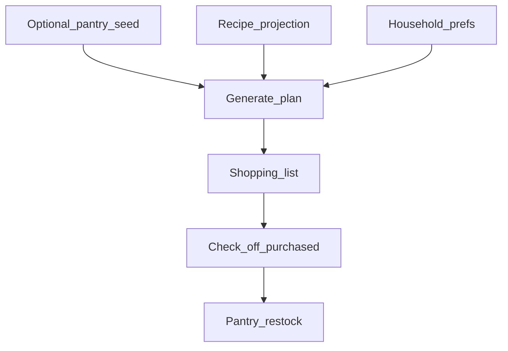
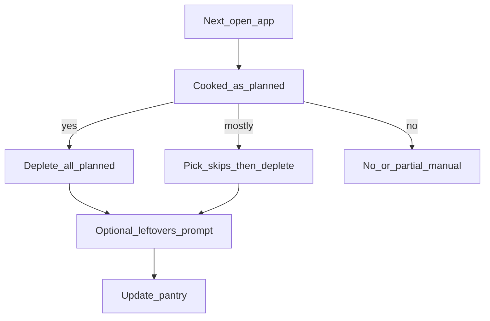

# PantryPilot — Detailed Implementation Plan

**Life Atlas Project 3** · Inventory-Aware Meal Prep  
**Location:** `LifeAtlas/pantry-pilot/`  
**Stack:** TypeScript, Node 20+, PostgreSQL (or SQLite for early spikes — ADR), Redis, BullMQ, OpenTelemetry  
**Integrations:** RecipeHub HTTP API + `lifeatlas.recipe.*` consumer; later TripWeaver `lifeatlas.trip.dates_changed`

---

## Product goal

Remove **daily meal decision fatigue** for exhausted 9–5 households: open the app and see a plan for the next N days (default **3**) plus a shopping list that fills pantry gaps. Meals are matched against a **shared household pantry** using RecipeHub’s canonical ingredient ids.

**Wedge:** *Plan meals from what’s in the pantry (and only shop the gaps).*  
**Later mode:** Pre-trip **wind-down** — same planner, `objective=use_stock`, horizon = days until departure (TripWeaver dates).

**Core principle:** Deterministic code owns inventory mutations and plan selection. AI may explain or tie-break in v2 — never silently change stock. Recipes are **not** owned here: create/update via RecipeHub API; plan from a local recipe projection fed by events.

---

## v1 scope

### In scope

- **Multi-household** tenancy; **one pantry + one plan + one shopping list per household**
- First-run: household size, soft **budget** target, plan horizon (default 3), breakfast on, lunch off; optional short pantry **seed**; skip seed ⇒ empty pantry + shop-heavy first list
- Meals: **breakfast + dinner**; lunch toggle default **off**; minimal weekday breakfast recipes (from RecipeHub starters); skip breakfast = opt-out toggle (default on)
- Coarse inventory: ingredient id + rough qty + optional expiry
- Shopping list from plan gaps; **check-off purchased** → restock pantry
- **“Cooked as planned?”** confirmation (all / mostly with skips / no) → deplete pantry; optional leftovers prompt
- Deterministic planner: score recipes by pantry overlap, expiry urgency, budget soft-fit, repeat penalty, meal slot
- Recipe projection/cache from RecipeHub events; HTTP client for recipe create/update
- BullMQ jobs: plan generation, event ingestion, deferred confirmations
- Docker Compose: API/worker + Postgres + Redis (+ broker client as needed)
- Docs package per Life Atlas standard

### Out of v1

- Receipt OCR / parse-and-confirm
- Wind-down / TripWeaver consumption
- Hybrid AI planner
- Per-person meal overrides / calorie targets
- Rich household member invites/roles UX
- RecipeHub UI (lives in RecipeHub v2)
- Publishing `recipe.*` events (RecipeHub only) — retire any publish-lab framing in this folder

---

## Repository layout

```
pantry-pilot/
├── src/
│   ├── api/                    # HTTP routes (or separate apps/api)
│   ├── workers/                # BullMQ processors
│   ├── domain/                 # Household, pantry, plan, shopping pure logic
│   ├── planner/                # Deterministic scoring pipeline
│   ├── integrations/
│   │   ├── recipeHubClient.ts  # HTTPS CRUD to RecipeHub
│   │   └── recipeEvents.ts     # Kafka/SNS/SQS consumer → projection
│   ├── db/                     # Migrations, repositories
│   └── index.ts
├── tests/
├── docs/
│   ├── system-design.md
│   ├── trade-offs.md
│   ├── production-next.md
│   ├── integration.md
│   └── adr/
├── docker-compose.yml
├── package.json
└── README.md
```

**Note:** Existing EDA practice files (SNS/Kafka **publish** of recipes) are a false start for this product’s publishing role. Reuse consumer/config ideas; do not treat PantryPilot as recipe source of truth.

**Architecture:** domain + planner unit-testable without Redis/HTTP; integrations behind ports.

---

## Domain model (v1)

| Aggregate / entity | Responsibility |
|--------------------|----------------|
| `Household` | Tenant; size; soft budget; meal toggles; plan horizon default |
| `PantryItem` | Ingredient id, quantity, unit, optional expiry, updatedAt |
| `RecipeProjection` | Cached recipe from events/API for offline planning resilience |
| `MealPlan` | Horizon start/end, objective (`normal` \| later `use_stock`), status |
| `PlannedMeal` | Date, slot (breakfast/dinner/lunch), recipe id, portions |
| `ShoppingList` | Derived lines: ingredient id, qty to buy, checked flag |
| `PlanConfirmation` | Cooked response + skips + leftovers notes |
| `HouseholdPreferences` | Lean prefs; drip-in fields later |

**Value objects:** `Quantity`, `Unit` (aligned with RecipeHub), `MealSlot`, `PlanHorizon`, `BudgetTarget`

---

## Core loops

### Plan + shop



### Confirm cooked



---

## Deterministic planner (v1)

Scoring inputs (weights documented in ADR):

1. **Pantry overlap** — fraction of recipe ingredients already in stock (quantity-aware, coarse)
2. **Expiry urgency** — boost recipes using soon-to-expire items
3. **Budget soft-fit** — penalize high estimated shop cost vs remaining soft budget (rough unit costs optional/stub)
4. **Repeat penalty** — avoid same recipe id within horizon
5. **Meal slot fit** — breakfast pool vs dinner pool (starter pack tags)

**Outputs:** ordered `PlannedMeal[]` + shopping gap list. User may swap/replace a slot (v1: replace with next-best candidate).

**Wind-down (v2):** same pipeline with `objective=use_stock`, heavier pantry/expiry weights, clamp new SKUs on shopping list.

---

## API surface (v1)

| Method | Path | Purpose |
|--------|------|---------|
| POST | `/households` | Create household + first-run prefs |
| GET/PATCH | `/households/{id}` | Get/update prefs (size, budget, horizon, meal toggles) |
| GET | `/households/{id}/pantry` | List pantry |
| PUT | `/households/{id}/pantry` | Upsert coarse items (seed or edit) |
| POST | `/households/{id}/plans` | Generate plan for horizon |
| GET | `/households/{id}/plans/current` | Current plan |
| POST | `/households/{id}/plans/{planId}/confirm` | Cooked as planned (+ skips/leftovers) |
| GET | `/households/{id}/shopping-lists/current` | Current list |
| POST | `/households/{id}/shopping-lists/{id}/checkoffs` | Check off purchased → restock |
| GET | `/health` | Health check |

**Not in PantryPilot:** recipe create/update — clients call RecipeHub directly (future UI redirects to RecipeHub UI). Read-only `RecipeHubClient` for ingredients/recipes as needed.

**Errors:** RFC 9457-style JSON problem body (TS equivalent)

---

## Integrations

### RecipeHub (required for rich planning)

| Direction | Mechanism |
|-----------|-----------|
| Outbound | HTTPS **list/get** recipes and ingredients (no write proxy) |
| Inbound | Consume `lifeatlas.recipe.created` / `updated` / `deleted` → upsert/soft-remove `RecipeProjection` (Kafka primary, Week 2) |

Degraded mode: if RecipeHub/events down, plan from last projection + show stale banner (standalone rule).

### TripWeaver (v2)

| Event | Use |
|-------|-----|
| `lifeatlas.trip.dates_changed` / `planned` | Offer wind-down plan to departure date |

---

## AI boundary

| Step | Owner | Notes |
|------|-------|-------|
| Plan generation | Deterministic planner | v1 only path |
| Inventory mutations | Domain + user confirm | Never AI |
| Explain “why this meal?” | AI adapter | **v2**; grounded in score breakdown |
| Receipt parse | AI + confirm UI | **v2** |

---

## Required ADRs

| ADR | Topic |
|-----|-------|
| ADR-001 | Recipe ownership in RecipeHub vs local recipes |
| ADR-002 | Coarse inventory + confirm-cooked vs per-meal logging — **Accepted** |
| ADR-003 | BullMQ job boundaries (plan, ingest, confirm) — **Accepted** |
| ADR-004 | Planner scoring weights and test strategy — **Accepted** |
| ADR-005 | Recipe projection freshness and degraded mode — **Accepted** |
| ADR-006 | Postgres vs SQLite for v1 local/dev — **Accepted: Postgres** |
| ADR-007 | JWT auth aligned with RecipeHub (shared Dev JWT) |
| ADR-008 | No recipe write proxy; RecipeHub owns writes/UI |
| ADR-009 | Kafka primary for recipe ingest (no HTTP poll sync) |

---

## Key trade-offs (document in `docs/trade-offs.md`)

| Decision | Options | Recommended v1 | Why |
|----------|---------|----------------|-----|
| Primary job | Wind-down first vs meal prep first | Meal prep first | Daily dogfooding; wind-down is same engine later |
| Inventory accuracy | Silent household-size deduct vs confirm | Confirm cooked | Trust > clever drift |
| Receipts | OCR in v1 vs later | Later | Don’t block planner loop |
| Meals | 3 mains vs B+D | B+D; lunch off | Less list noise; breakfast still structured |
| Planner | AI-first vs deterministic | Deterministic | Testable; Life Atlas AI rule |
| Recipe publish | This service vs RecipeHub | RecipeHub only | One writer |
| Recipe write API | Proxy vs RecipeHub direct | RecipeHub direct | No second editor; UI redirects later |
| Database | SQLite spike vs Postgres | Postgres day one | Prod parity |
| Event ingest | Poll vs Kafka vs SNS | Kafka Week 2 | Match RecipeHub; no throwaway sync |
| Households | Members now vs one owner | One household per user (v1) | Extensible via membership later |

---

## What I'm proving vs learning

| Proving (CV-aligned) | Learning (owned depth) |
|----------------------|------------------------|
| TypeScript service + Redis/BullMQ | Inventory ↔ plan ↔ shop closed loop that users will actually update |
| Event-driven consumer + HTTP client to .NET peer | Deterministic multi-objective meal scoring |
| Human-in-the-loop confirmations | Multi-tenant household product (not solo-only script) |

---

## Milestones (4 weeks, part-time)

| Week | Deliverable |
|------|-------------|
| **1** | Scaffold, household/pantry schema, coarse pantry API, RecipeHub client stub, docs skeleton, Compose |
| **2** | Recipe event consumer + projection, deterministic planner, plan + shopping list APIs |
| **3** | Check-off restock, confirm-cooked deplete, BullMQ jobs, first-run seed flow |
| **4** | Integration docs, trade-offs/ADRs, demo script, polish degraded modes |

### Accelerated (~8–10 focused days)

| Phase | Days | Focus |
|-------|------|-------|
| **A** | 2 | Household + pantry + seed |
| **B** | 3 | Projection + planner + plan/list |
| **C** | 2 | Check-off + confirm-cooked |
| **D** | 2 | Jobs, docs, demo |

**Depends on:** RecipeHub Week 1–2 (catalog + recipes + at least console events or shared seed JSON for parallel work).

---

## Demo script (GitHub README)

1. Create household (size 2, budget, horizon 3)
2. Skip pantry seed → generate plan → show shop-heavy list
3. Check off purchases → pantry filled
4. Confirm cooked → pantry reduced
5. Generate next plan → show pantry-aware choices
6. Add custom recipe via **RecipeHub** API → event → appears in next plan candidates

---

## Definition of done

- [x] v1 loop works locally: seed/skip → plan → shop check-off → confirm cooked → re-plan
- [x] Minimum 5 trade-offs + 6 ADRs
- [x] Planner unit tests for scoring invariants
- [x] RecipeHub integration documented and demoed (`npm run demo`, docs/integration.md)
- [x] No recipe publish path presented as PantryPilot’s job
- [x] `production-next.md` covers wind-down, receipts, AI explain, members

---

## Production-next (outline)

1. Wind-down mode + TripWeaver consumer
2. Receipt parse-and-confirm
3. Hybrid AI explain / tie-break
4. Household member invites and shared check-off
5. Per-person meal overrides + calorie targets
6. Mobile-friendly UI / LifeConsole readiness tile
7. Observability on planner latency and confirm rates

---

## To be refined (v2+)

- **Receipt** parse-and-confirm → inventory
- **Hybrid AI** planner (explain / tie-break); deterministic remains authority for stock
- **Lunch** as common default; richer breakfast variety
- **Wind-down mode** — `objective=use_stock`, horizon to trip departure; clamp shopping
- **Per-person meal overrides** on shared pantry; optional **calorie targets**
- **Household members** — invites, roles, shared shopping UX
- **Progressive preference prompts** (cuisine, cook time, variety) beyond first run
- Ingredient **“did you mean?”** UX when picking pantry items (coord with RecipeHub C)

---

## Thread starter prompt

```
Implement PantryPilot v1 Week 1 from LifeAtlas/pantry-pilot/PLAN.md:
- TypeScript Node scaffold with domain + API layout
- Household + coarse pantry CRUD, first-run seed/skip
- RecipeHub HTTP client stub, Docker Compose with Postgres + Redis
- Docs skeleton; do not build full planner until Week 2
Follow PLAN.md. Do not publish recipe.* events from this service.
```
